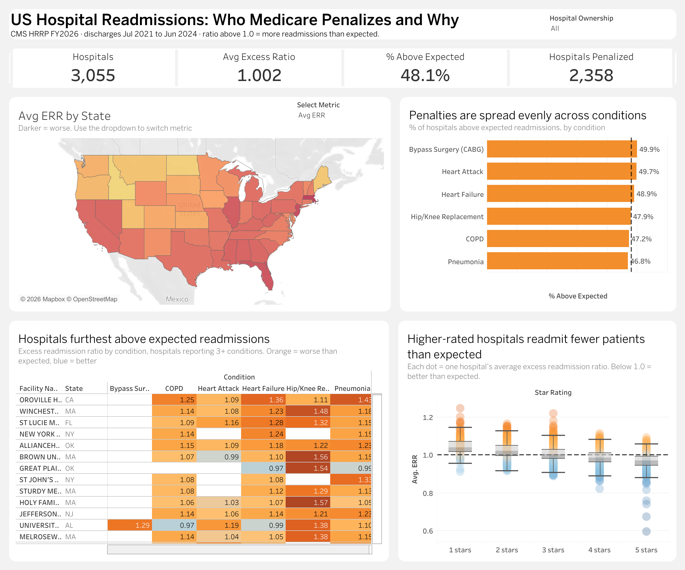

# US Hospital Readmissions: Who Medicare Penalizes and Why

An interactive Tableau dashboard analyzing 30-day readmission performance for **3,055 US hospitals** under Medicare's Hospital Readmissions Reduction Program (HRRP), FY2026.

**[View the live dashboard on Tableau Public](https://public.tableau.com/app/profile/chamodh.perera/viz/Hospital_Readmissions_17930777373540/USHospitalReadmissions)**



---

## Business question

Medicare reduces payments to hospitals that readmit more patients within 30 days than expected for their patient mix. This dashboard answers:

1. How widespread is excess readmission across US hospitals?
2. Which states and hospitals perform worst?
3. Do hospital quality ratings and ownership type explain the differences?

## Key findings

- **Hospital star rating is the strongest signal.** Average excess readmission ratio (ERR) falls at every rating level: **1.045** for 1-star hospitals, 1.023 (2-star), 1.006 (3-star), 0.986 (4-star) and **0.964** for 5-star hospitals.
- **Geography matters.** Massachusetts (1.034), New Jersey (1.028) and Florida (1.023) have the highest average ERR. Idaho (0.943), North Dakota (0.947) and Maine (0.952) have the lowest. In New Jersey, 65% of hospital-condition results are above expected.
- **Ownership shows a gap.** For-profit (proprietary) hospitals average 1.017, with 55% of results above expected. Physician-owned hospitals average 0.954 (38%).
- **Condition type is not the driver.** All six conditions sit between 46.8% and 49.9% above expected, because CMS calibrates each condition's ratio around 1.0.
- **77% of hospitals (2,358)** are above expected on at least one condition.

## Data

| Dataset | Source | Grain |
|---|---|---|
| Hospital Readmissions Reduction Program (FY2026) | [CMS Provider Data, 9n3s-kdb3](https://data.cms.gov/provider-data/dataset/9n3s-kdb3) | Hospital × condition (18,330 rows) |
| Hospital General Information | [CMS Provider Data, xubh-q36u](https://data.cms.gov/provider-data/dataset/xubh-q36u) | Hospital (5,419 rows) |

- Performance period: discharges from July 2021 to June 2024
- Six conditions: heart attack (AMI), heart failure, pneumonia, COPD, coronary artery bypass graft (CABG) surgery, and hip/knee replacement
- **Excess Readmission Ratio (ERR)** = predicted readmission rate ÷ expected readmission rate. Above 1.0 means more readmissions than expected.

## Approach

**Data model.** The two tables are joined with a Tableau **relationship** on `Facility ID`, kept as a string to preserve leading zeros. The relationship keeps each table at its own grain, so hospital attributes are not duplicated across the six condition rows.

**Data cleaning.** Suppressed values (`N/A`, `Too Few to Report`) are converted to NULL with `FLOAT()`, so they are excluded from averages rather than counted as zero.

**Key calculations**

```
// Clean ratio
ERR = FLOAT([Excess Readmission Ratio])

// Share of hospital-condition results above expected
% Above Expected = SUM(IF [ERR] > 1 THEN 1 ELSE 0 END)
                 / SUM(IF NOT ISNULL([ERR]) THEN 1 END)

// LOD: flag hospitals above expected on any condition
Hospital Penalized Flag = { FIXED [Facility ID] : MAX(IF [ERR] > 1 THEN 1 ELSE 0 END) }
# Hospitals Penalized   = COUNTD(IF [Hospital Penalized Flag] = 1 THEN [Facility ID] END)

// LOD: hospital-level average for the star rating chart and ranking
Hospital Avg ERR = { FIXED [Facility ID] : AVG([ERR]) }

// LOD: conditions reported, used to rank only hospitals with 3+ conditions
# Conditions Reported = { FIXED [Facility ID] : COUNT([ERR]) }
```

**Dashboard features**

- KPI band: hospitals, average ERR, % above expected, and hospitals penalized
- State map with a **parameter** to switch between Avg ERR, % Above Expected and Total Readmissions
- **Filter action**: click a state to filter every chart
- Diverging highlight table (orange = worse, blue = better, centered at 1.0)
- Box plot of hospital ERR by CMS star rating
- Hospital Ownership filter applied across all sheets

## Limitations

- "Hospitals Penalized" counts hospitals with an ERR above 1.0 on at least one condition. It is a proxy: the actual payment reduction CMS applies also depends on a hospital's peer group and payment weights.
- 20 hospitals in the HRRP file have no match in Hospital General Information, so they show as null ownership and "Not rated".
- 222 hospitals have no reported ERR because of small case volumes, and unrated hospitals are excluded from the star rating chart.
- These are observational differences. They show association, not cause.

## Repository structure

```
hospital-readmissions-analysis/
├── README.md
├── data/
│   ├── FY_2026_Hospital_Readmissions_Reduction_Program_Hospital.csv
│   └── Hospital_General_Information.csv
├── tableau/
│   └── Hospital_Readmissions.twbx
└── images/
    └── dashboard.png
```

To explore the workbook, open `tableau/Hospital_Readmissions.twbx` in Tableau Desktop or the free Tableau Public app.

## Tools

Tableau Public · Python (pandas) for data validation

---

**Author:** Chamodh Perera · Data Analyst, Southern California
